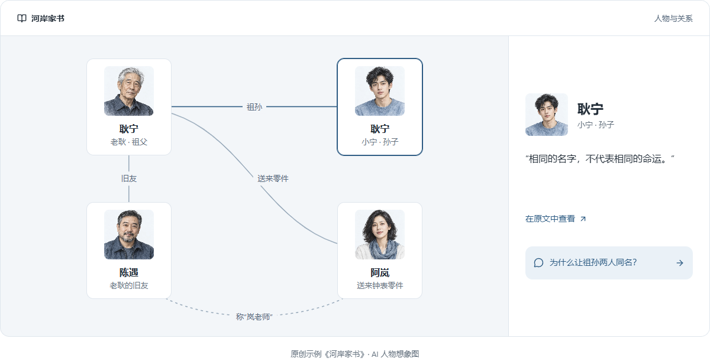
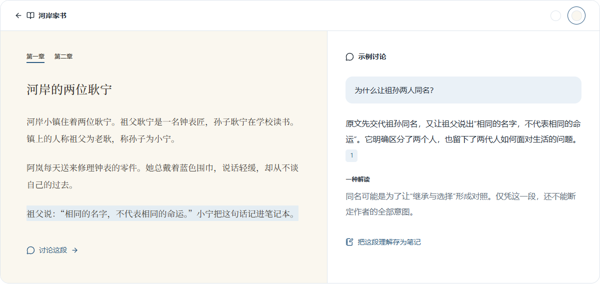
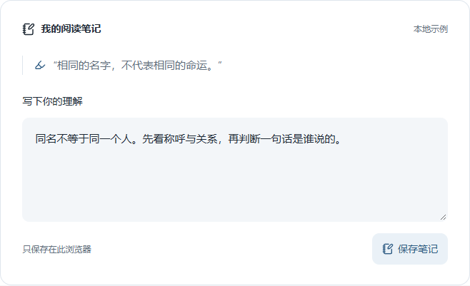

<p align="center">
  <a href="https://gengreader.com">
    
  </a>
</p>

<h1 align="center">一本书，<br />也是一场长谈。</h1>

<p align="center">
  理清人物关系，与 AI 深聊每一页，把读到的变成自己的理解。
</p>

<p align="center">
  <strong>EPUB / PDF · 无需安装 · 桌面与手机均可阅读</strong>
</p>

<p align="center">
  <a href="https://gengreader.com"><strong>打开 GengReader →</strong></a>
  &nbsp; · &nbsp;
  <a href="https://gengreader.com/#characters">先看看怎么读</a>
  &nbsp; · &nbsp;
  <a href="./src/core">核心代码</a>
  &nbsp; · &nbsp;
  <a href="#常见问题">常见问题</a>
</p>

---

GengReader 是一个 AI 辅助的深度阅读工作台。带来一本 EPUB 或 PDF，把阅读、提问、查证和记下想法放在同一个地方。无论是小说里错综复杂的人物，还是非小说里值得推敲的观点，都可以从原文出发，慢慢读明白。

## 先看清人物，再读懂故事。

名字相似的人物、跨越章节的关系、还没有揭晓的身份，把它们放在同一张图里。从人物档案回到原文，沿着引用继续追问，让理解有据可循。

<a href="https://gengreader.com/#characters">
  
</a>

<p align="center"><sub>官网交互示例 · 原创故事《河岸家书》 · 人物画像为 AI 想象</sub></p>

## 不止读过，还要读懂。

忘记的人物，回到原文认清。没想通的观点，与 AI 继续追问。讨论中的引用可以跳回原文，让你一边阅读，一边核对与思考。

<a href="https://gengreader.com/#reading">
  
</a>

<p align="center"><sub>官网阅读与讨论示例，图中对话为预写演示，并非实时模型输出。</sub></p>

## 合上书，想法还在。

划过的句子、追问的答案、突然想通的一点，放回同一本书里。下次打开，接着自己的思路往下读。

- **留下句子**：用高亮和笔记记住重要段落，保留原文出处。
- **留下理解**：把讨论中值得保存的想法整理为阅读笔记。
- **看清结构**：借助思维导图梳理章节、观点和它们之间的联系。

<a href="https://gengreader.com/#notes">
  
</a>

<p align="center"><sub>官网笔记交互示例，演示内容仅保存在当前浏览器。</sub></p>

## 从一本书开始

| 阅读时想做的事   | GengReader 提供的方式                          |
| ---------------- | ---------------------------------------------- |
| 安静地把书读下去 | EPUB 排版、PDF 页面、目录、书签与阅读进度      |
| 想起一个人是谁   | 人物档案、别名、关系图和原文来源               |
| 把一个观点问明白 | AI 讨论、流式回答、引用跳转和多会话            |
| 把零散想法串起来 | 高亮、笔记、思维导图，以及 Markdown / SVG 导出 |
| 按自己的节奏读   | 默认按已读范围提供内容，主动选择整章或整书分析 |

## 核心代码

想了解 GengReader 是怎样实现的，可以直接查看 [原创核心模块](./src/core/) 和 [代码导读](./docs/CODE_GUIDE.md)。这里保留应用实际使用的算法逻辑，并提供可独立运行的演示和测试。

| 实现主题           | 代码入口                                                                                              |
| ------------------ | ----------------------------------------------------------------------------------------------------- |
| 已读范围与原文引用 | [范围裁切](./src/core/scope-range.ts) · [证据检索与引用校验](./src/core/ai-evidence.ts)               |
| 人物理解           | [身份与同名判断](./src/core/character-identity.ts) · [主要人物排序](./src/core/character-salience.ts) |
| 图形与画像资料     | [关系图布局](./src/core/character-layout.ts) · [画像资料整理](./src/core/portrait-material.ts)        |
| 流式讨论           | [SSE 事件传输](./src/core/ai-chat-stream.ts)                                                          |

安装 Node.js 22.14+ 和 pnpm 10 后，在仓库目录运行：

```sh
pnpm install --frozen-lockfile
pnpm demo
pnpm test
```

演示不需要密钥，不调用收费模型。这里是核心实现选集；完整网站体验请前往 [gengreader.com](https://gengreader.com)。

## 常见问题

<details>
<summary><strong>适合读什么书？</strong></summary>

文学、历史、哲学、社科与专业书籍都可以。小说可以借助人物关系理清故事；非小说可以围绕概念和论证讨论，并用笔记和导图整理理解。

</details>

<details>
<summary><strong>需要下载软件吗？</strong></summary>

不需要。在电脑或手机浏览器打开 [gengreader.com](https://gengreader.com) 即可。上传自己的书籍和保存阅读记录需要登录。

</details>

<details>
<summary><strong>支持哪些文件？</strong></summary>

支持 EPUB 和 PDF。扫描版 PDF 可以先阅读页面；基于扫描页文字的讨论需要配置 OCR 服务。

</details>

<details>
<summary><strong>会提前剧透吗？</strong></summary>

默认按已读位置提供内容；整章和整书分析由你主动选择。人物、关系与引用也遵守阅读范围。AI 解读仍可能有误，重要判断请回到原文核对。

</details>

<details>
<summary><strong>这里能直接体验吗？</strong></summary>

这个 GitHub 仓库提供产品介绍、界面图片和原创核心代码。源码演示的运行方式见 [代码导读](./docs/CODE_GUIDE.md)；完整的交互示例和阅读功能请前往 [GengReader 官网](https://gengreader.com)。官网示例使用原创《河岸家书》，演示笔记保存在当前浏览器；账户内书籍与阅读记录按用户私有保存。

AI、OCR 和画像等功能的可用范围取决于线上服务配置，实际使用以网站提示为准。

</details>

---

<h2 align="center">下一页，读得更明白。</h2>

<p align="center">
  <a href="https://gengreader.com"><strong>开始读我的第一本书 →</strong></a>
</p>

<p align="center"><sub>GengReader · 一本书，也是一场长谈。</sub></p>
