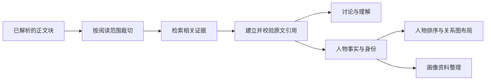

# GengReader 核心代码导读

这里公开的是 GengReader 应用新增的独立核心模块，用来了解产品如何处理证据、人物与阅读范围。产品介绍和截图仍放在仓库首页。

## 从哪里开始看

建议先运行 [reading-flow.ts](../examples/reading-flow.ts)，再沿下表阅读对应实现。

| 想了解的问题                           | 文件                                                       | 主要入口                                                                             |
| -------------------------------------- | ---------------------------------------------------------- | ------------------------------------------------------------------------------------ |
| 一段原文如何定位到书、章节和位置？     | [types.ts](../src/core/types.ts)                           | `ReaderBlock`、`ReadingLocation`、`ReaderScope`                                      |
| AI 结果怎样关联引用、人物与思维导图？  | [ai-types.ts](../src/core/ai-types.ts)                     | `ReaderCitation`、`ReaderCharacter`、`MindMapNode`                                   |
| 怎样截掉用户尚未读到的正文？           | [scope-range.ts](../src/core/scope-range.ts)               | `filterBlocksToRange`                                                                |
| 怎样选择证据、核对引用和过滤未读资料？ | [ai-evidence.ts](../src/core/ai-evidence.ts)               | `retrieveBlocks`、`validatedCitations`、`resolveAnswerCitations`、`filterCharacters` |
| 同名人物是否应该合并？                 | [character-identity.ts](../src/core/character-identity.ts) | `sameIdentity`、`stableRegistryMatch`、`supportedIdentityMerge`                      |
| 如何选出主要人物？                     | [character-salience.ts](../src/core/character-salience.ts) | `rankMainCharacters`                                                                 |
| 人物关系图如何排布、布线和放标签？     | [character-layout.ts](../src/core/character-layout.ts)     | `layoutCharacters`、`routeCharacterEdges`、`characterEdgeLabels`                     |
| 人物画像怎样使用已知资料？             | [portrait-material.ts](../src/core/portrait-material.ts)   | `portraitMaterial`                                                                   |
| AI 回答如何通过流式连接逐步发给界面？  | [ai-chat-stream.ts](../src/core/ai-chat-stream.ts)         | `chatStreamResponse`                                                                 |

## 阅读数据如何流转



本仓库的演示从已经构造好的正文块开始。实际应用负责把书籍解析成这些数据，再调用这里的核心模块。正文位置使用 UTF-16 偏移；文件版本、书籍与片段标识共同参与引用定位，不能只靠页码或人物名字判断同一条资料。

`scope-range.ts` 会截断超出阅读范围的文本并清空原始 HTML，避免文字虽已裁切、HTML 仍包含未读内容。`ai-evidence.ts` 提供词法检索和引用校验，也按阅读边界过滤人物资料；它不是向量数据库，也不能替代人工判断 AI 解读是否成立。

人物身份、重要程度和图形布局分成独立步骤：同名不自动等于同一个人；筛选主要人物后，再按关系和世代生成确定性的坐标。布局只计算几何位置，不绑定浏览器或某个 UI 框架。

`chatStreamResponse` 演示真实应用使用的 SSE 传输：先建立连接，再发出增量事件；连接取消时通知上游终止。它不包含模型服务密钥，也不会自行发起模型请求。

## 在本地运行

需要 Node.js 22.14 或更新版本，以及 pnpm 10。

```sh
git clone https://github.com/WGW-Muggle/GengReader-showcase.git
cd GengReader-showcase
pnpm install --frozen-lockfile
pnpm demo
pnpm test
pnpm typecheck
```

演示与测试使用自编短文本，不需要账号、数据库、环境变量或 AI API Key，也不会调用收费模型。

## 与完整网站的关系

这是一份核心实现选集，可以独立运行示例和测试，不能直接启动完整网站。完整应用还需要 EPUB/PDF 解析、认证、数据库、文件存储、后台任务和页面组件。

公开代码不包含 ShipAny 模板的应用骨架、认证、计费或数据库接入实现。源模块保持原有逻辑；只有阅读范围文件抽取了纯函数，测试文件调整了导入路径。逐文件来源和校验值见 [code-provenance.json](./code-provenance.json)。

本次公开用于代码阅读与交流，尚未为这些源码另行指定开源许可证。
